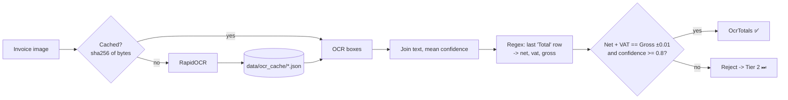
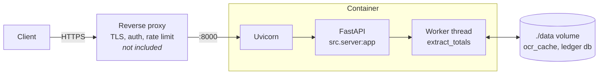
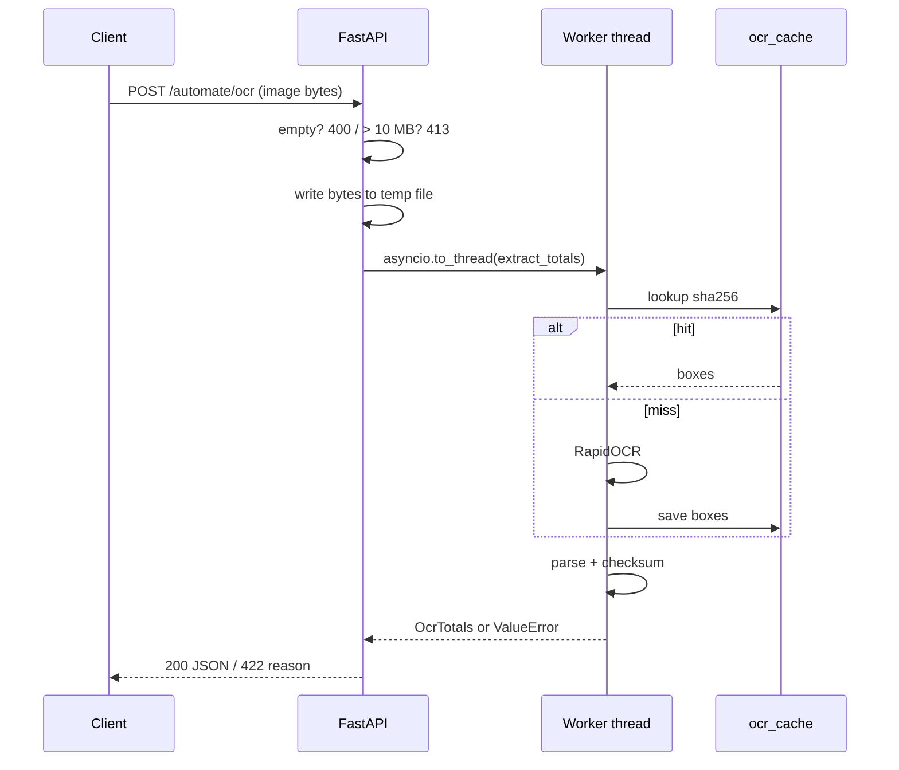

# Finago AI Copilot

Reference GenAI architecture for B2B finance and payroll (Finago Ask, Automate, Build). See [PLAN.md](PLAN.md) for the roadmap.

## Finago Automate: invoice totals from an image

Automate reads the totals row of an invoice image (net, VAT, gross) and only accepts the result if the numbers add up. Tier 1 is local and free: RapidOCR on CPU, plus an accounting checksum. Anything Tier 1 can't vouch for is escalated to Tier 2: a Vision LLM (`VISION_MODEL`, default `openai:gpt-4o-mini`, needs `OPENAI_API_KEY`) whose answer must pass the same checksum (no confidence gate; LLMs have no calibrated score). A failed checksum is fed back to the LLM to retry.



All of it lives in `src/automate/ocr.py`:

| Step | Function | Notes |
| --- | --- | --- |
| OCR + cache | `ocr_boxes(image)` | Keyed by SHA-256 of the image bytes, so renamed copies still hit. Hit about 10 ms, miss about 9-13 s. |
| Text + confidence | `ocr_text(image)` | Raises `ValueError` if no text is found. |
| Parse totals | `parse_totals(text, conf)` | The last `Total` row wins, because the summary sits at the bottom. |
| Validate | `OcrTotals` (pydantic) | Checksum and confidence gate; failure raises `ValidationError`. |
| All in one | `extract_totals(image)` | What callers use. |

Thresholds (`MIN_CONFIDENCE`, `CENT`) and the totals regex are in `src/constants.py`.

## How it's served

`src/server.py` is a FastAPI app. In production it runs in Docker under Uvicorn, with `./data` mounted so the ledger and the OCR cache survive restarts.



```bash
docker compose up --build        # production-style
uvicorn src.server:app --reload  # local dev
```

There's one Uvicorn process today, and OCR is CPU-heavy. To scale, add `--workers N` or move OCR to a job queue. Auth and TLS are expected from the proxy in front.

## The request: `POST /automate/ocr`

The body is the raw image bytes, not a multipart form.

```bash
curl --data-binary @data/invoices/train_000.png localhost:8000/automate/ocr
```



| Status | When | Body |
| --- | --- | --- |
| 200 | Totals pass the checksum and confidence gate | `{"total_net": 100.0, "total_vat": 10.0, "total_gross": 110.0, "confidence": 0.98}` |
| 400 | Empty body | `{"detail": "empty body; POST the image bytes"}` |
| 413 | Image larger than 10 MB | `{"detail": "image larger than ... bytes"}` |
| 422 | Tier 1 failed and Tier 2 still failed the checksum after retries | `{"detail": "Tier 2 failed: ..."}` |

OCR runs in a worker thread, so one slow image doesn't block other requests. Interactive docs are at `/docs`.

## Development

```bash
uv sync
uv run pytest -q
uv run ruff check . && uv run ruff format .
```
